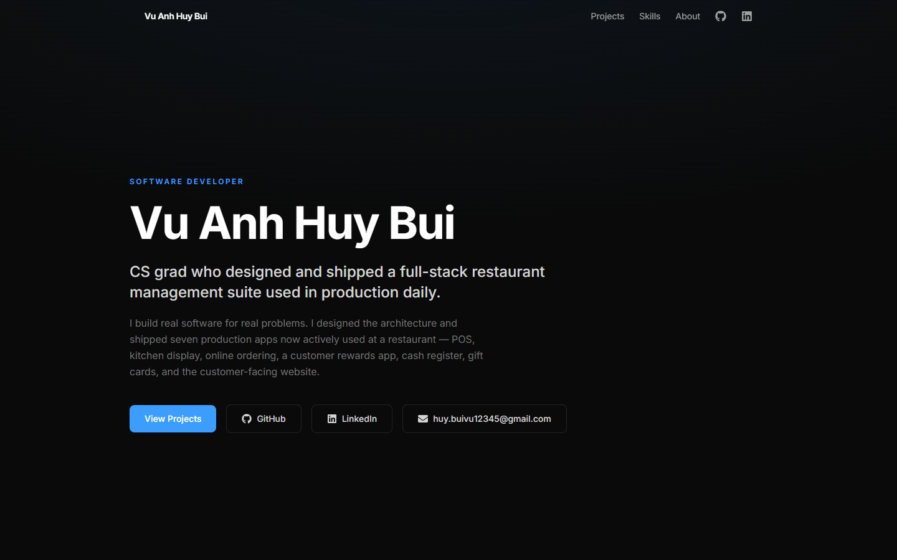

# Vu Anh Huy Bui — Portfolio

My personal portfolio site, live at **[buivuanhhuy.ca](https://www.buivuanhhuy.ca/)**.

It showcases the restaurant management suite I designed and built solo: POS, kitchen display, online ordering, a customer rewards app, cash register, gift cards, and the customer website, most of them used in production every day.



## Tech stack

- [Next.js 16](https://nextjs.org/) (App Router), React 19, TypeScript
- [Tailwind CSS v4](https://tailwindcss.com/)
- [Framer Motion](https://motion.dev/) for subtle scroll animations
- [Plyr](https://plyr.io/) for video playback, [React Icons](https://react-icons.github.io/react-icons/)

## How it works

A single scrollable page with no extra routes. Content and layout are kept separate:

- **`lib/content.ts`** holds all copy: hero, project descriptions, architecture notes, skills, and links. Updating the site's text never means touching a component.
- **`public/media/<slug>/`** holds each project's screenshots and videos. `lib/media.ts` reads the folder at build time, so adding media is just dropping files in. Files are shown in filename order, and an image with the same name as a video becomes its poster.
- **`components/`** has one component per section (`Hero`, `Projects`, `Skills`, `About`, …). Projects include a media carousel with a fullscreen viewer, plus optional App Store and live-site buttons.

```
app/          layout, page, global styles
components/   page sections
lib/          content.ts (copy), media.ts (media loader)
public/media/ per-project screenshots and videos
```

## Running locally

```bash
npm install
npm run dev     # http://localhost:3000
npm run build   # production build
npm run lint
```
